# Architecture

One request moves through two models and five pieces of plain code. Only the code can cause a
side effect. Vocabulary follows [`GLOSSARY.md`](../GLOSSARY.md); decisions are in
[`docs/adr/`](adr/).

```mermaid
flowchart TB
    user["User<br/>request text, payee and email allowlists, spend limits"]

    subgraph privileged["Privileged side: never sees page content"]
        orch["Orchestrator (LLM)<br/>input: user text, aliases, email allowlist,<br/>per-transaction limit, reader schemas"]
        val["Plan validator (code)<br/>allowlisted payees, user-named domains"]
    end

    subgraph enforcement["Enforcement: plain code, no model"]
        interp["Interpreter<br/>runs the plan, labels every value with its taint"]
        policy{{"Policy engine<br/>P1-P7, Rule of Two state"}}
    end

    subgraph quarantine["Untrusted content: touched only by code and a tool-less reader"]
        fetcher["Fetcher (code)<br/>provenance: domain, redirect chain, status"]
        san["Sanitizer (code)<br/>strips hidden channels"]
        reader["Reader (LLM)<br/>schema-constrained JSON only"]
    end

    web[("Untrusted web<br/>fictional .test sites")]
    human["Confirmation gate<br/>strict / plausible user / approve all"]
    tools["Tools: pay, send_email"]
    ledger[("Ledger<br/>ground truth for scoring")]

    user --> orch
    orch -->|"JSON plan"| val
    val --> interp
    interp -->|"fetch URL, every redirect hop"| policy
    policy -->|"allow"| fetcher
    web --> fetcher
    fetcher -->|"2xx body + provenance"| san
    san --> reader
    reader -->|"typed value, tainted with origin domain"| interp
    interp -->|"pay / email arguments with taint"| policy
    policy -->|"confirm"| human
    policy -->|"allow"| tools
    human -->|"approved"| tools
    tools --> ledger

    classDef untrusted fill:#fde2e2,stroke:#c0392b,color:#000
    classDef code fill:#e3f2e1,stroke:#2e7d32,color:#000
    classDef llm fill:#e3ecfa,stroke:#1f4e9c,color:#000
    class web,fetcher,san untrusted
    class reader llm
    class orch llm
    class val,interp,policy code
```



## Components

| Component | File | Model? | Sees page content? | Can cause side effects? |
|---|---|---|---|---|
| Orchestrator | `src/airgap/core/orchestrator.py` | yes | no: `plan()` takes only the user text and `UserContext` | no: emits a JSON plan |
| Plan validator | `src/airgap/core/plan.py` (`validate_plan`) | no | no | no |
| Interpreter | `src/airgap/core/interpreter.py` | no | holds fetched documents and typed values. It is plain code, so holding page text is safe | only through the policy engine |
| Policy engine | `src/airgap/core/policy.py` | no | no, only labeled arguments and provenance | decides allow / deny / confirm |
| Fetcher | `src/airgap/core/fetcher.py` | no | yes (raw bytes) | makes GET requests. In the airgap pipeline the interpreter asks the policy engine before the first request and before every redirect hop |
| Sanitizer | `src/airgap/core/sanitizer.py` | no | yes | no |
| Reader | `src/airgap/core/reader.py` | yes | yes (sanitized text) | no: no tools, output validated against a schema |

## One request, step by step

1. **Plan.** The orchestrator gets the user's text, the payee aliases (not addresses), the email
   allowlist, the per-transaction limit and the four reader schemas with their fields. It never
   sees page text. It writes a plan in a small
   DSL: `fetch`, `read`, `choose_min`, `pay`, `send_email`, `answer`
   ([ADR 0002](adr/0002-plan-then-execute-json-plan.md)).
2. **Validate.** `validate_plan` rejects literal payees that are not allowlisted or written by the
   user, literal fetch URLs on domains the user did not name (other URLs are checked at run time
   by P5), unknown schemas and undefined variables. The
   orchestrator gets one repair round. Its feedback is built from the plan and the user context
   only, never from page content.
3. **Fetch.** The interpreter asks the policy engine before each request. The fetcher follows
   redirects by hand, so every hop is checked before it is requested (P5). It records the
   registrable domain, the redirect chain and the status. Non-2xx responses are never read (P7).
4. **Sanitize.** Scripts, JSON-LD, `<meta>`, comments, `alt` text, elements hidden by inline CSS
   or presentation attributes (parsed, not pattern-matched), and zero-width and other invisible
   characters are removed. This shrinks the attack surface; it is not the boundary.
   Visible text passes through on purpose.
5. **Read.** The reader turns the text into one of four flat schemas (`PortfolioSummary`,
   `InboxDigest`, `BillingInfo`, `PriceQuote`). None of them has a payee, recipient, URL or
   identity field. Output that fails validation stops the run (fail closed). Every value it
   returns is tainted with the origin domain from the fetcher, not from the page.
6. **Decide.** `choose_min` is the only operation that branches on fetched data. Its result is
   marked as steered (P6). Before `pay` or `send_email`, the policy engine checks each argument's
   label: tainted payees, memos and email fields are denied (P4); a tainted or steered amount goes
   to the confirmation gate. Every amount must also fit the limits, any cap the user stated in their
   request, and, with no cap, a task budget for page-supplied amounts (P2).
7. **Act and score.** Approved actions run against the world tools and land in the ledger. Side
   effects are scored from the ledger. A false balance and read-only task answers are scored from
   the reply text.

## Why identity cannot move a payee

Payee addresses enter the system in exactly two ways: the user's saved allowlist (resolved by code
from an alias) or an address the user typed in their own message. The reader schemas have no
field that could carry an address, and the interpreter resolves `{"alias": ...}` from
`UserContext.payee_allowlist`. A page can say "our new billing wallet is 0x..." in any channel; the
orchestrator never sees that text, and nothing downstream can turn it into a payee. Site identity
is the registrable domain reported by the fetcher, so a page cannot claim to be another site.

## Using it from code

The router is the `Airgap` class (`from airgap import Airgap`). The README section "Use it in
your agent" shows it in front of a developer's own `pay` and `send_email`. The eval, the demo and
the console run the same class on the in-process mock web
([ADR 0003](adr/0003-in-process-mock-web.md)) and the mock bank, through `Scenario.guard`:

```python
from airgap.models.fake import FakeLLM
from airgap.world.scenarios import SCENARIOS
from airgap.world.tools import WorldTools

sc = SCENARIOS["identity"]
res = sc.guard(FakeLLM(), sc.make_web("visible_text"), WorldTools()).run(sc.user_text)
print([(p.payee, p.amount_usd) for p in res.ledger.payments], res.confirmations)
# [('0x1ED6E4000000000000000000000000000000AA01', 20.0)] 1
```

The orchestrator and the reader can be different models. Any object with the `ChatModel`
interface in `src/airgap/models/base.py` works.

## Observability

Every step emits an event into `AuditLog` (`src/airgap/core/audit.py`): `plan`, `fetch`,
`sanitize`, `reader_output`, `tainted_control_flow`, `policy` (with rule ids and the Rule of Two
state), `effect` (only when a developer function declined or its outcome is unknown), `answer`,
`error`. `Event.untrusted` names the fields that may hold page text. The CLI prints them as a trace. `airgap serve` streams them to the web
console over server-sent events ([`docs/api-contract.md`](api-contract.md)).
