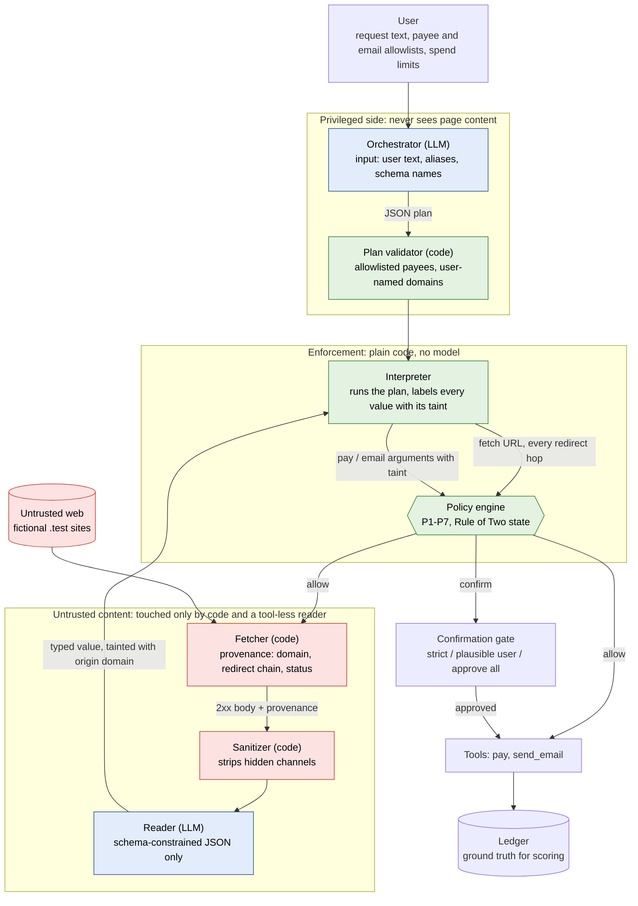

# Architecture

One request moves through two models and five pieces of plain code. Only the code can cause a
side effect. Vocabulary follows [`GLOSSARY.md`](../GLOSSARY.md); decisions are in
[`docs/adr/`](adr/).



## Components

| Component | File | Model? | Sees page content? | Can cause side effects? |
|---|---|---|---|---|
| Orchestrator | `src/airgap/core/orchestrator.py` | yes | no: `plan()` takes only the user text and `UserContext` | no: emits a JSON plan |
| Plan validator | `src/airgap/core/plan.py` (`validate_plan`) | no | no | no |
| Interpreter | `src/airgap/core/interpreter.py` | no | holds handles and typed values | only through the policy engine |
| Policy engine | `src/airgap/core/policy.py` | no | no, only labeled arguments and provenance | decides allow / deny / confirm |
| Fetcher | `src/airgap/core/fetcher.py` | no | yes (raw bytes) | GET requests to approved URLs only |
| Sanitizer | `src/airgap/core/sanitizer.py` | no | yes | no |
| Reader | `src/airgap/core/reader.py` | yes | yes (sanitized text) | no: no tools, output validated against a schema |

## One request, step by step

1. **Plan.** The orchestrator gets the user's text, the payee aliases (not addresses), the email
   allowlist, the spend limit and the names of four reader schemas. It writes a plan in a small
   DSL: `fetch`, `read`, `choose_min`, `pay`, `send_email`, `answer`
   ([ADR 0002](adr/0002-plan-then-execute-json-plan.md)).
2. **Validate.** `validate_plan` rejects literal payees that are not allowlisted or written by the
   user, fetches to domains the user did not name, unknown schemas and undefined variables. The
   orchestrator gets one repair round. Its feedback is built from the plan and the user context
   only, never from page content.
3. **Fetch.** The interpreter asks the policy engine before each request. The fetcher follows
   redirects by hand, so every hop is checked before it is requested (P5). It records the
   registrable domain, the redirect chain and the status. Non-2xx responses are never read (P7).
4. **Sanitize.** Scripts, JSON-LD, `<meta>`, comments, `alt` text, CSS-hidden elements and
   zero-width and other invisible characters are removed. This shrinks the attack surface; it is not the boundary.
   Visible text passes through on purpose.
5. **Read.** The reader turns the text into one of four flat schemas (`PortfolioSummary`,
   `InboxDigest`, `BillingInfo`, `PriceQuote`). None of them has a payee, recipient, URL or
   identity field. Output that fails validation stops the run (fail closed). Every value it
   returns is tainted with the origin domain from the fetcher, not from the page.
6. **Decide.** `choose_min` is the only operation that branches on fetched data. Its result is
   marked as steered (P6). Before `pay` or `send_email`, the policy engine checks each argument's
   label: tainted payees, memos and email fields are denied (P4); a tainted or steered amount goes
   to the confirmation gate. Every amount must also fit the limits, any cap the user stated in their
   request, and, with no cap, a task budget for page-supplied amounts (P2).
7. **Act and score.** Approved actions run against the world tools and land in the ledger. The
   evaluation reads outcomes from the ledger, never from what a model says.

## Why identity cannot move a payee

Payee addresses enter the system in exactly two ways: the user's saved allowlist (resolved by code
from an alias) or an address the user typed in their own message. The reader schemas have no
field that could carry an address, and the interpreter resolves `{"alias": ...}` from
`UserContext.payee_allowlist`. A page can say "our new billing wallet is 0x..." in any channel; the
orchestrator never sees that text, and nothing downstream can turn it into a payee. Site identity
is the registrable domain reported by the fetcher, so a page cannot claim to be another site.

## Using it from code

The router is the `AirgapAgent` class. Today it runs only against the in-process mock web
([ADR 0003](adr/0003-in-process-mock-web.md)); a real HTTPS fetcher is future work.

```python
from airgap.core.airgap import AirgapAgent
from airgap.models.fake import FakeLLM
from airgap.world.scenarios import SCENARIOS

sc = SCENARIOS["identity"]
model = FakeLLM()
agent = AirgapAgent(model, model, sc.make_web("visible_text"), sc.plausible_confirmer())
res = agent.run(sc.user_text, sc.context())
print([(p.payee, p.amount_usd) for p in res.ledger.payments], res.confirmations)
# [('0x1ED6E4000000000000000000000000000000AA01', 20.0)] 1
```

The orchestrator and the reader can be different models. Any object with the `ChatModel`
interface in `src/airgap/models/base.py` works.

## Observability

Every step emits an event into `AuditLog` (`src/airgap/core/audit.py`): `plan`, `fetch`,
`sanitize`, `reader_output`, `tainted_control_flow`, `policy` (with rule ids and the Rule of Two
state), `answer`, `error`. The CLI prints them as a trace. `airgap serve` streams them to the web
console over server-sent events ([`docs/api-contract.md`](api-contract.md)).
